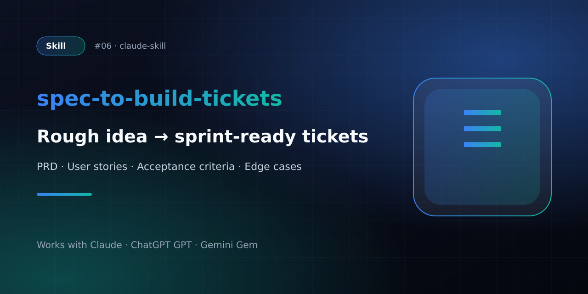

<p align="center"><a href="https://cloudskillhub.com"></a></p>

# spec-to-build-tickets

🌐 **Website:** [cloudskillhub.com](https://cloudskillhub.com) · 📦 **All skills:** [skillhub](https://github.com/jahirulofficial0/skillhub)

Turn a rough idea into a PRD, user stories, acceptance criteria, edge cases, and sprint-ready tickets a developer or coding agent can execute directly.

**Works with:** Claude (Code, Desktop, claude.ai) · ChatGPT custom GPT · Gemini Gem

## Install

### Claude Code — this skill only
```
/plugin marketplace add jahirulofficial0/skillhub
/plugin install spec-to-build-tickets@skillhub
```
Or directly from this repo: copy `skills/spec-to-build-tickets/` into `~/.claude/skills/`.

### All 10 skills at once
See **[skillhub](https://github.com/jahirulofficial0/skillhub)** — one marketplace, or one MCP server that serves all 10 skills.

### claude.ai
Download `skills/spec-to-build-tickets/` as a ZIP → **Settings → Capabilities → Skills → Upload skill**.

### ChatGPT / Gemini
- ChatGPT GPT: [`prompts/chatgpt-gpt.md`](prompts/chatgpt-gpt.md)
- Gemini Gem: [`prompts/gemini-gem.md`](prompts/gemini-gem.md)

## Usage
Just describe the task — the skill activates when relevant. Example:

> I want customers of my ISP to see their bill and pay online through bKash from a mobile web page.

See [`examples/`](examples/) for a full input → output sample.

## What you get
```
## PRD
### Problem / Goals / Non-goals / Users / Metrics / Scope
## User Stories & Acceptance Criteria
## Edge Cases
## Tickets
| ID | Title | Type | Est | Depends on |
### T-1 <title>
Description …
Acceptance criteria:
- [ ] Given … When … Then …
## Sprint Plan
```

## Repository layout
```
.claude-plugin/plugin.json   Claude Code plugin manifest
skills/spec-to-build-tickets/SKILL.md       The skill
prompts/                     ChatGPT GPT and Gemini Gem versions
examples/                    Sample input and output
assets/banner.png            Social preview image
```

## Author
**Jahirul** — [cloudskillhub.com](https://cloudskillhub.com) · [github.com/jahirulofficial0](https://github.com/jahirulofficial0)

## License
MIT — see [LICENSE](LICENSE).
